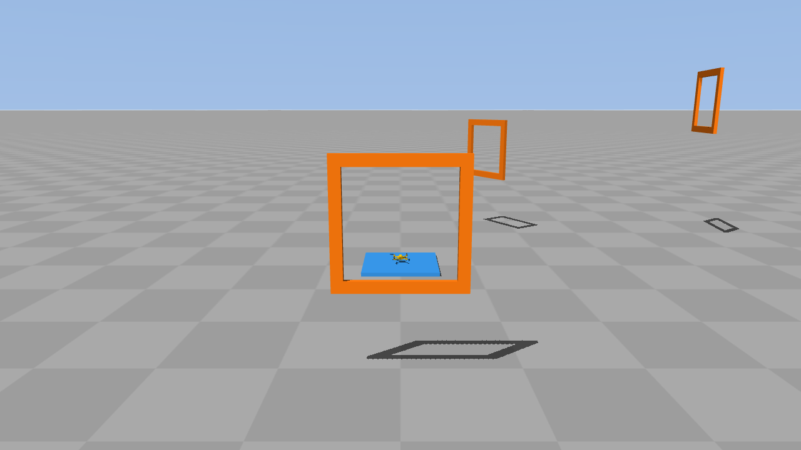
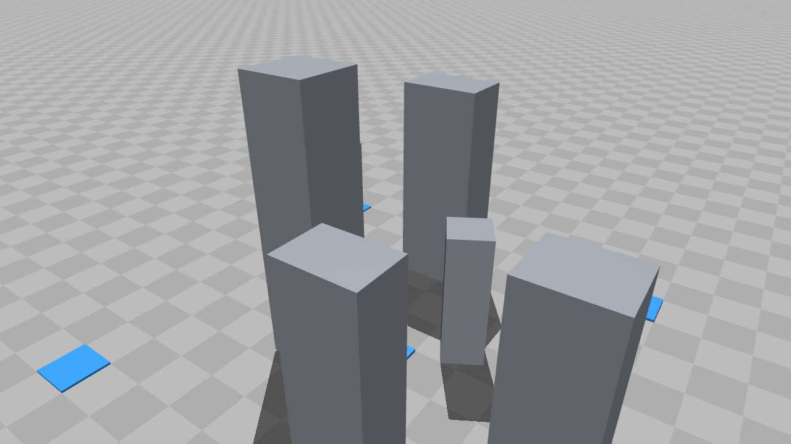

# bumble-bee-gym

A MuJoCo twin of the Bumble Bee quadrotor (the `bumble-bee` ROS 2 + Gazebo repo), plus obstacle and race courses that
render into **both** Gazebo and MuJoCo from one file. The idea: train a flight policy quickly in
MuJoCo, then fly that same policy back in Gazebo against the original ROS 2 stack.

Gazebo stays the reference. Nothing in this repo restates the drone's physics. Mass, inertia,
rotor layout, thrust map and yaw torque are all read from bumble-bee's `drone.urdf.xacro`, the
file Gazebo loads. Change the drone there and both simulators follow.

## Status

| Phase | What | State |
|---|---|---|
| 1 | One course file → Gazebo world + MuJoCo scene | done |
| 2 | MuJoCo twin, checked against Gazebo | done: within 5 mm and 0.4° over a 2 s open-loop flight |
| 3 | Obstacle course (`delivery_city`) flown by the PID mission with a path planner | next |
| 4 | Race course (`race_gates`) learned with PPO on the GPU (MJX) | planned |
| 5 | The trained policy flying in Gazebo as a ROS 2 node (ONNX) | planned |
| 6 | PID vs MPC vs neural network on the same courses | planned |

## Setup

Clone this repo next to bumble-bee (or set `BUMBLE_BEE_ROOT` to your bumble-bee checkout):

```
projects/
├── bumble-bee/       # ROS 2 + Gazebo package (the drone)
└── bumble-bee-gym/   # this repo
```

```bash
uv venv --python 3.12 && uv pip install -e '.[dev]'   # or: python -m venv .venv && pip install -e '.[dev]'
.venv/bin/pytest -q
```

## Courses

| `race_gates`, from the start line | `race_gates`, the 0.5 m needle gate | `delivery_city` |
|---|---|---|
|  |  |  |

MuJoCo renders from `scripts/render_course.py <course>` (offscreen on the GPU, no window).

A course is a short YAML file in `courses/`. Coordinates are metres, z up, yaw in degrees.

| Course | What's in it |
|---|---|
| `empty` | Ground only. The drone starts 2 m up; used by the parity test. |
| `delivery_city` | bumble-bee's delivery area (same 5 pads and 4 parcels) with 6 buildings blocking the straight-line routes. |
| `race_gates` | 8 gates on a 16 m × 10 m loop, 1 to 2.5 m high. Gate 5 is the needle: a 0.5 m opening for a drone 0.30 m across. |

```yaml
name: my_course
spawn: {xyz: [0, 0, 0.1], yaw: 0}
pads:      [{xyz: [0, 0]}]                                  # 1 x 1 x 0.1 m landing pads
parcels:   [{model: box_0, xyz: [0.5, 2.0]}]                # bumble-bee's 12 cm, 0.1 kg boxes
buildings: [{xyz: [3, 4], size: [2, 2, 6], yaw: 0}]         # footprint centre, x/y/height
gates:     [{xyz: [4, 0, 1.5], yaw: 90, opening: [0.8, 0.8]}]  # fly through along the gate's yaw
```

Render them:

```bash
.venv/bin/python scripts/build_worlds.py            # all courses -> generated/<name>.world and .xml
.venv/bin/python scripts/build_worlds.py race_gates
```

Fly a course in Gazebo by passing the generated world and a spawn pose to bumble-bee's launch file
(inside the bumble-bee container, with this repo mounted at `/gym`):

```bash
ros2 launch drone_delivery gazebo.launch.py world:=/gym/generated/race_gates.world x:=0 y:=0
```

Use the course's `spawn` position for `x`, `y` (and `z`, `yaw`).

Open the MuJoCo scene in the viewer:

```bash
.venv/bin/python -m mujoco.viewer --mjcf generated/race_gates.xml
```

## How the MuJoCo twin is built

- **Body.** One free body carrying the whole drone's mass (0.73 kg), centre of mass and inertia,
  combined from the URDF's links exactly as Gazebo sees them. The meshes are visual only.
- **Rotors.** One `motor` actuator per rotor site. Its control is that rotor's thrust in newtons,
  and its `gear` also applies the yaw reaction torque (0.016 N·m per newton, signed by the rotor's
  spin direction). The plugin does the same thing.
- **Speeds → thrust.** Policies and controllers command rotor speeds in rad/s, as on the
  `/motor_speed` topic. `DroneParams.thrust()` converts them with the plugin's own thrust map and
  rotor-speed limit.
- **World.** 1 ms timestep, gravity 9.8 m/s², matching the generated Gazebo worlds.

## The parity test

The same open-loop rotor-speed profile is flown in both simulators from the same mid-air start.
It runs hover, then a collective climb, a roll step, and a yaw step, and by 2 s the drone has
rolled past 75°. There is no controller in the loop, so any modelling difference shows up
directly and grows over time.

| Largest difference over 2 s | |
|---|---|
| Position (x / y / z) | 0.02 / 4.5 / 3.9 mm |
| Roll / pitch / yaw | 0.35° / 0.07° / 0.06° |

`tests/data/` holds the Gazebo recording, so `pytest` checks MuJoCo against it without needing
Docker. To re-record it after changing the drone:

```bash
docker build -f ../bumble-bee/docker/Dockerfile -t bumble-bee ../bumble-bee   # once
scripts/run_gazebo_parity.sh                                     # -> generated/gazebo_parity.*
cp generated/gazebo_parity.csv generated/gazebo_parity.switch.txt tests/data/
```

The recording runs Gazebo headless at a tenth of real time. Each 1 ms physics step then takes
10 ms of wall time, so every command reaches the plugin before the step it is meant for. The
probe uses the pose message's stamp, which the plugin sets to the sim time of that state.

## Layout

```
bumble_bee_gym/
  params.py   drone parameters read from bumble-bee's URDF and plugin block
  course.py   course YAML → dataclasses
  worlds.py   course → Gazebo SDF world and MuJoCo MJCF scene
  parity.py   shared open-loop profile, MuJoCo replay, comparison
courses/      course definitions
scripts/      build_worlds.py, render_course.py, run_gazebo_parity.sh, gazebo_parity_probe.py (ROS 2 node)
docs/media/   course renders
tests/        twin and course tests, with the recorded Gazebo flight in tests/data/
```
