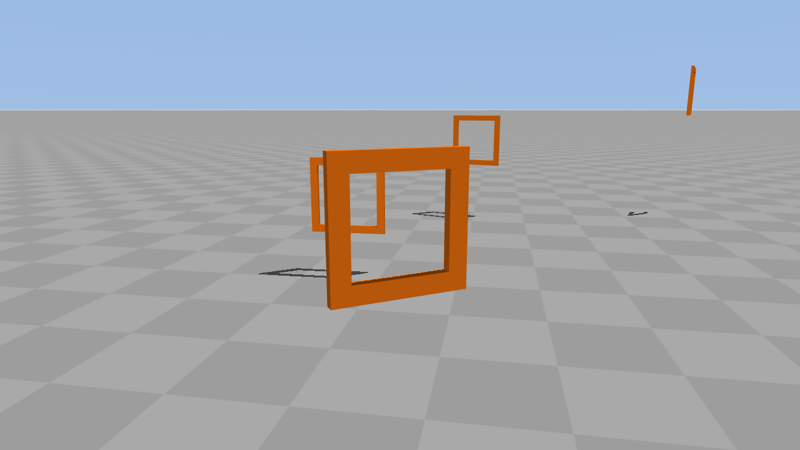
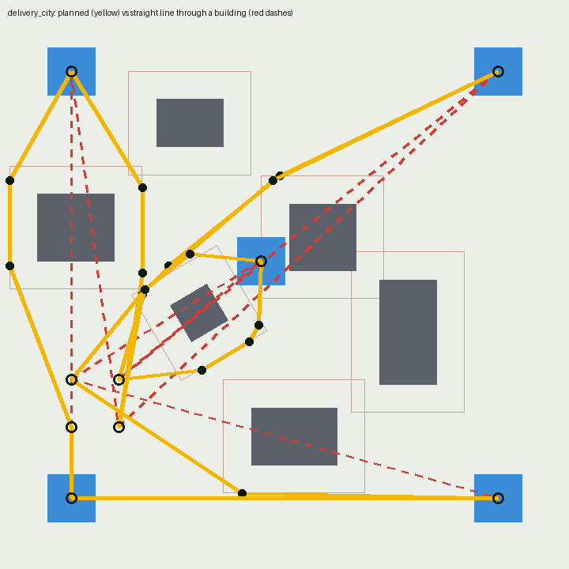
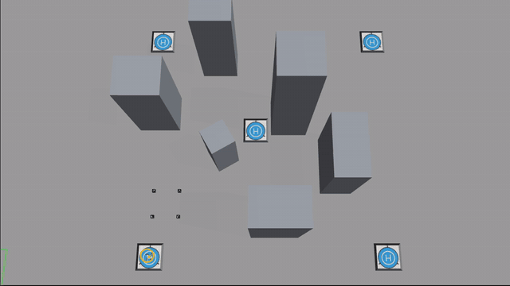
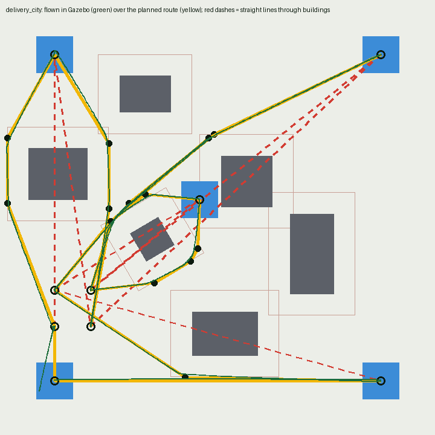

# bumble-bee-gym

A MuJoCo twin of the Bumble Bee quadrotor (the `bumble-bee` ROS 2 + Gazebo repo), plus obstacle and race courses that
render into **both** Gazebo and MuJoCo from one file. The idea: train a flight policy quickly in
MuJoCo, then fly that same policy back in Gazebo against the original ROS 2 stack.

Gazebo stays the reference. Nothing in this repo restates the drone's physics. Mass, inertia,
rotor layout, thrust map and yaw torque are all read from bumble-bee's `drone.urdf.xacro`, the
file Gazebo loads. Change the drone there and both simulators follow.

## Status

| Phase | What | State |
|---|---|---|
| 1 | One course file → Gazebo world + MuJoCo scene | done |
| 2 | MuJoCo twin, checked against Gazebo | done: within 5 mm and 0.4° over a 2 s open-loop flight |
| 3 | Obstacle course (`delivery_city`) flown by the PID mission with a path planner | done: all 4 deliveries in Gazebo, closest approach 0.47 m |
| 4 | Race course (`race_gates`) learned with PPO on the GPU (MJX) | race learned and flown in Gazebo at real time (10/10 runs) |
| 5 | The trained policy flying in Gazebo as a ROS 2 node (ONNX) | planned |
| 6 | PID vs MPC vs neural network on the same courses | planned |

## Setup

Clone this repo next to bumble-bee (or set `BUMBLE_BEE_ROOT` to your bumble-bee checkout):

```
projects/
├── bumble-bee/       # ROS 2 + Gazebo package (the drone)
└── bumble-bee-gym/   # this repo
```

```bash
uv venv --python 3.12 && uv pip install -e '.[dev]'   # or: python -m venv .venv && pip install -e '.[dev]'
.venv/bin/pytest -q
```

## Courses

| `race_gates`, from the start line | `race_gates`, the 0.5 m needle gate | `delivery_city` |
|---|---|---|
|  |  |  |

MuJoCo renders from `scripts/render_course.py <course>` (offscreen on the GPU, no window).

A course is a short YAML file in `courses/`. Coordinates are metres, z up, yaw in degrees.

| Course | What's in it |
|---|---|
| `empty` | Ground only. The drone starts 2 m up; used by the parity test. |
| `delivery_city` | bumble-bee's delivery area (same 5 pads and 4 parcels) with 6 buildings blocking the straight-line routes. |
| `race_gates` | 8 gates on a 16 m × 10 m loop, 1 to 2.5 m high. Gate 5 is the needle: a 0.5 m opening for a drone 0.30 m across. |

```yaml
name: my_course
spawn: {xyz: [0, 0, 0.1], yaw: 0}
pads:      [{xyz: [0, 0]}]                                  # 1 x 1 x 0.1 m landing pads
parcels:   [{model: box_0, xyz: [0.5, 2.0]}]                # bumble-bee's 12 cm, 0.1 kg boxes
buildings: [{xyz: [3, 4], size: [2, 2, 6], yaw: 0}]         # footprint centre, x/y/height
gates:     [{xyz: [4, 0, 1.5], yaw: 90, opening: [0.8, 0.8]}]  # fly through along the gate's yaw
```

Render them:

```bash
.venv/bin/python scripts/build_worlds.py            # all courses -> generated/<name>.world and .xml
.venv/bin/python scripts/build_worlds.py race_gates
```

Fly a course in Gazebo by passing the generated world and a spawn pose to bumble-bee's launch file
(inside the bumble-bee container, with this repo mounted at `/gym`):

```bash
ros2 launch drone_delivery gazebo.launch.py world:=/gym/generated/race_gates.world x:=0 y:=0
```

Use the course's `spawn` position for `x`, `y` (and `z`, `yaw`).

Open the MuJoCo scene in the viewer:

```bash
.venv/bin/python -m mujoco.viewer --mjcf generated/race_gates.xml
```

## Flying around buildings (planned missions)

`delivery_city` is bumble-bee's delivery area with six buildings in the way: 7 of the mission's 9
straight-line legs run through one. A course's `mission:` block lists the home pad, cruise height
and pickup → drop pairs. The planner then routes every leg around the buildings, offline:

```bash
.venv/bin/python scripts/plan_mission.py delivery_city    # -> missions/delivery_city.yaml + .png
```



- **What counts as an obstacle.** Every building taller than the cruise height (0.7 m), as its
  footprint rectangle (rotation included).
- **Clearance.** Paths keep 0.59 m from every wall: the drone's 0.19 m radius (props reach 0.184 m
  from the centre) plus a 0.40 m margin for tracking error and corner cutting.
- **Search.** A* on a 5 cm grid, 8-connected, then string pulling: from each kept point, jump to the
  farthest point still in clear view. A leg that is already clear stays a single straight line.
- **Result.** 68.7 m flown instead of 64.8 m. No leg is more than 20% longer than its straight line,
  and planning the whole mission takes under a second.

- **Trajectories.** Each leg also gets a minimum-snap curve through the same route
  (`bumble_bee_gym/trajectory.py`): 7th-order segments, smooth up to the 6th derivative, at rest at both
  ends, at most 2 m/s and 2 m/s². Long runs get extra knots every metre so the speed can plateau; segment
  times are scaled to the limits, then shortened one at a time while they hold; any segment whose curve
  comes within 0.55 m of a wall is split and refitted. The whole mission plans in about 8 s.

bumble-bee's `deliver` node flies the file with `-p mission:=<path>/missions/delivery_city.yaml`
(see bumble-bee's README › Flying around obstacles). In a headless Gazebo run on
`generated/delivery_city.world`, it delivered all four parcels to their pads and landed home. The
drone's centre came no closer than 0.47 m to a wall, so the props kept 0.28 m clear. A second, recorded run came
no closer than 0.53 m.





Flying the trajectories (`-p route_mode:=trajectory`) against steering at each corner, same route, same
Gazebo world, both with the controller timed from the pose stamps:

| | Corner by corner | Min-snap trajectory |
|---|---|---|
| Time flying between stops (to within 10 cm of each pad) | 107.6 s | 74.2 s |
| Whole mission, first leg to home | 189.0 s | 164.1 s |
| Near-stops mid-leg (< 0.3 m/s after > 0.6 m/s, > 0.5 m from the pad) | 10 | 0 |
| Top speed | 3.3 m/s | 2.0 m/s |
| Closest approach to a wall | 0.50 m | 0.47 m |

All of the gain is at the corners: on the long straight legs the corner-by-corner controller sprints at
3.3 m/s and is as fast or faster.

Check any flight log the same way, or draw it over the plan:

```bash
.venv/bin/python scripts/check_clearance.py delivery_city pose.csv   # CSV columns t,x,y,z
.venv/bin/python scripts/plot_flight.py delivery_city pose.csv -o flight.png
```

## How the MuJoCo twin is built

- **Body.** One free body carrying the whole drone's mass (0.73 kg), centre of mass and inertia,
  combined from the URDF's links exactly as Gazebo sees them. The meshes are visual only.
- **Rotors.** One `motor` actuator per rotor site. Its control is that rotor's thrust in newtons,
  and its `gear` also applies the yaw reaction torque (0.016 N·m per newton, signed by the rotor's
  spin direction). The plugin does the same thing.
- **Speeds → thrust.** Policies and controllers command rotor speeds in rad/s, as on the
  `/motor_speed` topic. `DroneParams.thrust()` converts them with the plugin's own thrust map and
  rotor-speed limit.
- **World.** 1 ms timestep, gravity 9.8 m/s², matching the generated Gazebo worlds.

## The parity test

The same open-loop rotor-speed profile is flown in both simulators from the same mid-air start.
It runs hover, then a collective climb, a roll step, and a yaw step, and by 2 s the drone has
rolled past 75°. There is no controller in the loop, so any modelling difference shows up
directly and grows over time.

| Largest difference over 2 s | |
|---|---|
| Position (x / y / z) | 0.02 / 4.5 / 3.9 mm |
| Roll / pitch / yaw | 0.35° / 0.07° / 0.06° |

`tests/data/` holds the Gazebo recording, so `pytest` checks MuJoCo against it without needing
Docker. To re-record it after changing the drone:

```bash
docker build -f ../bumble-bee/docker/Dockerfile -t bumble-bee ../bumble-bee   # once
scripts/run_gazebo_parity.sh                                     # -> generated/gazebo_parity.*
cp generated/gazebo_parity.csv generated/gazebo_parity.switch.txt tests/data/
```

The recording runs Gazebo headless at a tenth of real time. Each 1 ms physics step then takes
10 ms of wall time, so every command reaches the plugin before the step it is meant for. The
probe uses the pose message's stamp, which the plugin sets to the sim time of that state.

## Layout

```
bumble_bee_gym/
  params.py   drone parameters read from bumble-bee's URDF and plugin block
  course.py   course YAML → dataclasses
  worlds.py   course → Gazebo SDF world and MuJoCo MJCF scene
  parity.py   shared open-loop profile, MuJoCo replay, comparison
  planner.py  A* around building footprints + string pulling; plans a course's whole mission
courses/      course definitions (delivery_city also defines its mission)
missions/     planned missions for bumble-bee's deliver node (generated, kept in git)
scripts/      build_worlds.py, render_course.py, plan_mission.py, check_clearance.py, plot_flight.py,
              run_gazebo_parity.sh, gazebo_parity_probe.py (ROS 2 node)
docs/media/   course renders
tests/        twin and course tests, with the recorded Gazebo flight in tests/data/
```

## Learning: one hoop

`courses/one_hoop.yaml`: a 0.8 m hoop 1.5 m up. Each episode the drone starts 2 to 5 m in front of it at a random
height, sideways offset, attitude and velocity, and has 5 s to fly through. The policy commands the four rotor
speeds at 100 Hz, as bumble-bee's `fly` node does (`bumble_bee_gym/learn/hoop_env.py` has the observation, reward
and the frame-touch check).

Training runs in sprout-gym's GPU image (`sprout-playground`: JAX, MuJoCo MJX, Brax PPO):

```bash
bumble_bee_gym/learn/run.sh hoop_04 train --timesteps 60e6     # ~3.5 min, shares the GPU (35% memory cap)
bumble_bee_gym/learn/run.sh hoop_04 play                       # score 1000 random starts + outputs/hoop_04/hoop.mp4
```

| Run | Steps | Through the hoop (1000 random starts) | Time to go through | Speed through |
|---|---|---|---|---|
| hoop_04 | 64M | 96.3% (3.7% touch the frame) | 0.75 s | 10.6 m/s |

Nothing limits its speed yet, so it learns to rush the hoop; the physics has no air drag.

## Racing the gates, at real time in Gazebo

`learn/gates_env.py` races `race_gates` lap after lap from random starts on every leg. Training includes the delays
and imperfections of the real control loop (`learn/realism.py`). Each episode draws:

- a 2–12 ms command delay, plus 0–6 ms of jitter each step;
- up to 15 ms of motor lag;
- drag;
- ±3% thrust;
- sensor noise.

Gazebo at real time measured 5–10 ms from pose to command, with occasional spikes to 20 ms. Pass
`--set real.enabled=false` for instant, perfect physics.

```bash
bumble_bee_gym/learn/run.sh gates_07 train --env gates --timesteps 150e6 \
    --restore /app/outputs/gates_02/checkpoints/000024576000 --ppo learning_rate=3e-5 num_evals=30
bumble_bee_gym/learn/run.sh gates_07 play_gates --checkpoint 000019660800 --no_film   # score 1000 random starts
python -m bumble_bee_gym.learn.export_policy --name gates_07 --checkpoint 000019660800  # (playground image) -> .npz
scripts/run_gazebo_race.sh outputs/gates_07/policy_000019660800.npz 15                  # Gazebo, real time
```

In Gazebo, `scripts/gazebo_race_pilot.py` flies like a flight computer:

- It runs a 100 Hz wall-clock loop on the newest pose, so it never falls behind.
- It sends rotor speeds to bumble-bee's plugin on `/motor_speed`.
- It logs how old each pose was when its command went out.

Gazebo runs at real time by default; `SLOW=1` runs it at a tenth of real time.

| Policy | MuJoCo: 1000 random starts, with the effects | Without them | Gazebo, real time, 10 runs from the start line |
|---|---|---|---|
| gates_02 @ 24.6M | 12% laps, 93% crash | 99% laps, 1% crash | 10/10 complete, 33 gates in 15 s |
| gates_07 @ 19.7M | 92% laps, 11% crash | 96% laps, 4% crash | 10/10 complete, 32 gates in 15 s |

PPO on this task is unstable: runs peak, then collapse into touching gate frames. So pick the checkpoint by scoring
the saved ones (`--checkpoint`), not by taking the last one.
